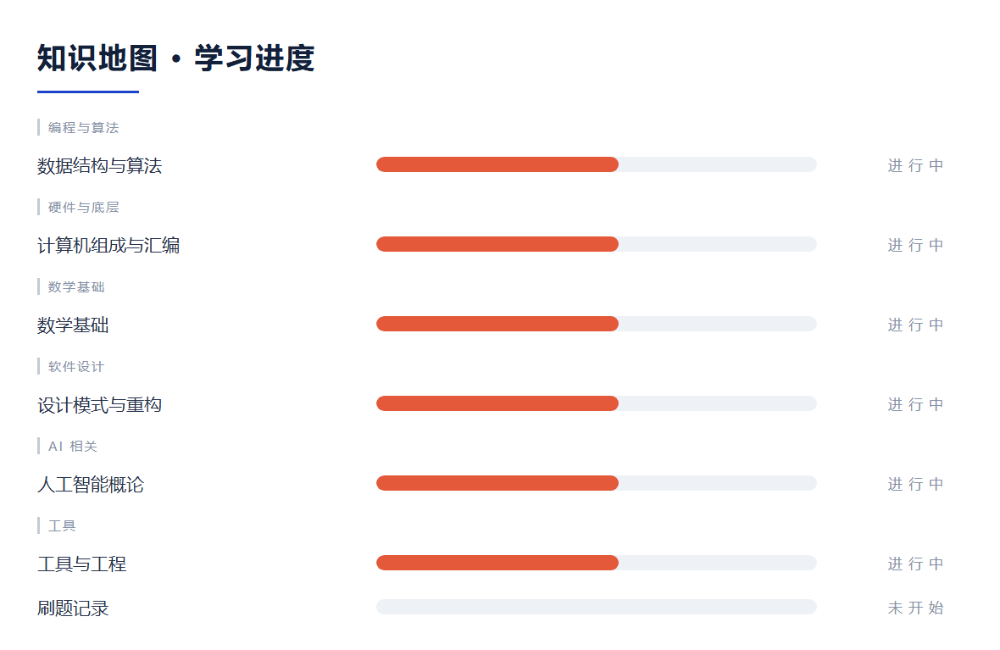

<a id="top"></a>

<div align="center">


<!-- BADGE:BEGIN -->
[](#map)
[](#map)
[](#todo)
<!-- BADGE:END -->


</div>

---

<!-- NAV:BEGIN -->
<div align="center">

[🗺️ 知识地图](#map)　｜　[📌 待学](#todo)　｜　[🧪 实战](#practice)　｜　[🔍 概念](#concepts)　｜　[📂 分类导航](#nav)

</div>

<a id="nav"></a>

## 📂 分类导航

| 目录 | 笔记 |
|---|---|
| `人工智能概论/` | [词元化_词向量与Transformer架构](人工智能概论/20261013_词元化_词向量与Transformer架构.md) ｜ [注意力机制_预训练范式与位置编码演进](人工智能概论/20261020_注意力机制_预训练范式与位置编码演进.md) |
| `刷题记录/` | [README](刷题记录/README.md) |
| `工具与工程/` | [Linux与Git工作流](工具与工程/20260921_Linux与Git工作流.md) |
| `数学基础/` | [条件概率与独立性](数学基础/20260921_条件概率与独立性.md) ｜ [量词辖域](数学基础/20260921_量词辖域.md) ｜ [多维随机变量与二维分布](数学基础/20261009_多维随机变量与二维分布.md) ｜ [二元连续型随机变量与独立性判定](数学基础/20261010_二元连续型随机变量与独立性判定.md) ｜ [N元随机变量与卷积公式](数学基础/20261014_N元随机变量与卷积公式.md) ｜ [随机变量函数的分布_差积和与最值](数学基础/20261016_随机变量函数的分布_差积和与最值.md) |
| `数据结构与算法/` | [链表反转与合并递减链表](数据结构与算法/20260921_链表反转与合并递减链表.md) ｜ [多维数组寻址与特殊矩阵压缩存储](数据结构与算法/20261008_多维数组寻址与特殊矩阵压缩存储.md) |
| `离散数学/` | [函数_置换与集合基数](离散数学/20261015_函数_置换与集合基数.md) ｜ [离散数学期中试题解答](离散数学/20261015_离散数学期中试题解答.md) |
| `计算机组成与汇编/` | [DEBUG单步调试与标志位](计算机组成与汇编/20260918_DEBUG单步调试与标志位.md) ｜ [寻址方式与EA计算](计算机组成与汇编/20260918_寻址方式与EA计算.md) ｜ [汇编程序框架与转移指令](计算机组成与汇编/20260922_汇编程序框架与转移指令.md) ｜ [DEBUG与算术运算指令（课设第二次）](计算机组成与汇编/20260927_DEBUG与算术运算指令（课设第二次）.md) ｜ [DEBUG基本命令与数据传输指令（课设第一次）](计算机组成与汇编/20260927_DEBUG基本命令与数据传输指令（课设第一次）.md) ｜ [BCD码调整指令与乘除法](计算机组成与汇编/20261009_BCD码调整指令与乘除法.md) |
| `设计模式与重构/` | [依赖倒置原则](设计模式与重构/20260921_依赖倒置原则.md) ｜ [Java入门资源](设计模式与重构/20260928_Java入门资源.md) ｜ [控制反转实现路径与六条设计原则](设计模式与重构/20261012_控制反转实现路径与六条设计原则.md) ｜ [23种模式的分类与创建型模式](设计模式与重构/20261019_23种模式的分类与创建型模式.md) ｜ [里氏替换原则与合成复用原则](设计模式与重构/20261019_里氏替换原则与合成复用原则.md) |
| `马克思主义基本原理/` | [软件众包案例_实践标准与价值论](马克思主义基本原理/20261014_软件众包案例_实践标准与价值论.md) |

<a id="timeline"></a>

## 📅 时间线

| 日期 | 位置 | 笔记 |
|---|---|---|
| 2026-10-21 | `数学基础/` | [数学期望的定义与二项分布期望推导](数学基础/20261021_数学期望的定义与二项分布期望推导.md) |
| 2026-10-20 | `计算机组成与汇编/` | [汇编2023半期试题与修正解答](计算机组成与汇编/20261020_汇编2023半期试题与修正解答.md) |
| 2026-10-20 | `计算机组成与汇编/` | [存储器写周期时序与PC总线标准](计算机组成与汇编/20261020_存储器写周期时序与PC总线标准.md) |
| 2026-10-20 | `计算机组成与汇编/` | [8284时钟发生器三问](计算机组成与汇编/20261020_8284时钟发生器三问.md) |
| 2026-10-20 | `人工智能概论/` | [注意力机制_预训练范式与位置编码演进](人工智能概论/20261020_注意力机制_预训练范式与位置编码演进.md) |
| 2026-10-19 | `设计模式与重构/` | [里氏替换原则与合成复用原则](设计模式与重构/20261019_里氏替换原则与合成复用原则.md) |
| 2026-10-19 | `设计模式与重构/` | [23种模式的分类与创建型模式](设计模式与重构/20261019_23种模式的分类与创建型模式.md) |
| 2026-10-19 | `计算机组成与汇编/` | [奇偶统计实验（段结构·循环·分支）](计算机组成与汇编/20261019_奇偶统计实验（段结构·循环·分支）.md) |
| 2026-10-19 | `计算机组成与汇编/` | [MOV操作数合法性判定（做题经验）](计算机组成与汇编/20261019_MOV操作数合法性判定（做题经验）.md) |
| 2026-10-16 | `数学基础/` | [随机变量函数的分布_差积和与最值](数学基础/20261016_随机变量函数的分布_差积和与最值.md) |
| 2026-10-15 | `离散数学/` | [离散数学期中试题解答](离散数学/20261015_离散数学期中试题解答.md) |
| 2026-10-15 | `离散数学/` | [函数_置换与集合基数](离散数学/20261015_函数_置换与集合基数.md) |
| 2026-10-14 | `马克思主义基本原理/` | [软件众包案例_实践标准与价值论](马克思主义基本原理/20261014_软件众包案例_实践标准与价值论.md) |
| 2026-10-14 | `数学基础/` | [N元随机变量与卷积公式](数学基础/20261014_N元随机变量与卷积公式.md) |
| 2026-10-13 | `计算机组成与汇编/` | [逻辑运算与移位指令（课设第三次）](计算机组成与汇编/20261013_逻辑运算与移位指令（课设第三次）.md) |
| 2026-10-13 | `计算机组成与汇编/` | [BCD除法调整_多精度运算与8088总线](计算机组成与汇编/20261013_BCD除法调整_多精度运算与8088总线.md) |
| 2026-10-13 | `人工智能概论/` | [词元化_词向量与Transformer架构](人工智能概论/20261013_词元化_词向量与Transformer架构.md) |
| 2026-10-12 | `设计模式与重构/` | [控制反转实现路径与六条设计原则](设计模式与重构/20261012_控制反转实现路径与六条设计原则.md) |
| 2026-10-10 | `数学基础/` | [二元连续型随机变量与独立性判定](数学基础/20261010_二元连续型随机变量与独立性判定.md) |
| 2026-10-09 | `计算机组成与汇编/` | [BCD码调整指令与乘除法](计算机组成与汇编/20261009_BCD码调整指令与乘除法.md) |
| 2026-10-09 | `数学基础/` | [多维随机变量与二维分布](数学基础/20261009_多维随机变量与二维分布.md) |
| 2026-10-08 | `数据结构与算法/` | [多维数组寻址与特殊矩阵压缩存储](数据结构与算法/20261008_多维数组寻址与特殊矩阵压缩存储.md) |
| 2026-09-28 | `设计模式与重构/` | [Java入门资源](设计模式与重构/20260928_Java入门资源.md) |
| 2026-09-27 | `计算机组成与汇编/` | [DEBUG基本命令与数据传输指令（课设第一次）](计算机组成与汇编/20260927_DEBUG基本命令与数据传输指令（课设第一次）.md) |
| 2026-09-27 | `计算机组成与汇编/` | [DEBUG与算术运算指令（课设第二次）](计算机组成与汇编/20260927_DEBUG与算术运算指令（课设第二次）.md) |
| … |  | 共 33 篇 |

[↑ 回到顶部](#top)

<a id="timeline"></a>

## 📅 时间线

| 日期 | 位置 | 笔记 |
|---|---|---|
| 2026-10-21 | `数学基础/` | [数学期望的定义与二项分布期望推导](数学基础/20261021_数学期望的定义与二项分布期望推导.md) |
| 2026-10-20 | `计算机组成与汇编/` | [汇编2023半期试题与修正解答](计算机组成与汇编/20261020_汇编2023半期试题与修正解答.md) |
| 2026-10-20 | `计算机组成与汇编/` | [存储器写周期时序与PC总线标准](计算机组成与汇编/20261020_存储器写周期时序与PC总线标准.md) |
| 2026-10-20 | `计算机组成与汇编/` | [8284时钟发生器三问](计算机组成与汇编/20261020_8284时钟发生器三问.md) |
| 2026-10-20 | `人工智能概论/` | [注意力机制_预训练范式与位置编码演进](人工智能概论/20261020_注意力机制_预训练范式与位置编码演进.md) |
| 2026-10-19 | `设计模式与重构/` | [里氏替换原则与合成复用原则](设计模式与重构/20261019_里氏替换原则与合成复用原则.md) |
| 2026-10-19 | `设计模式与重构/` | [23种模式的分类与创建型模式](设计模式与重构/20261019_23种模式的分类与创建型模式.md) |
| 2026-10-19 | `计算机组成与汇编/` | [奇偶统计实验（段结构·循环·分支）](计算机组成与汇编/20261019_奇偶统计实验（段结构·循环·分支）.md) |
| 2026-10-19 | `计算机组成与汇编/` | [MOV操作数合法性判定（做题经验）](计算机组成与汇编/20261019_MOV操作数合法性判定（做题经验）.md) |
| 2026-10-16 | `数学基础/` | [随机变量函数的分布_差积和与最值](数学基础/20261016_随机变量函数的分布_差积和与最值.md) |
| 2026-10-15 | `离散数学/` | [离散数学期中试题解答](离散数学/20261015_离散数学期中试题解答.md) |
| 2026-10-15 | `离散数学/` | [函数_置换与集合基数](离散数学/20261015_函数_置换与集合基数.md) |
| 2026-10-14 | `马克思主义基本原理/` | [软件众包案例_实践标准与价值论](马克思主义基本原理/20261014_软件众包案例_实践标准与价值论.md) |
| 2026-10-14 | `数学基础/` | [N元随机变量与卷积公式](数学基础/20261014_N元随机变量与卷积公式.md) |
| 2026-10-13 | `计算机组成与汇编/` | [逻辑运算与移位指令（课设第三次）](计算机组成与汇编/20261013_逻辑运算与移位指令（课设第三次）.md) |
| 2026-10-13 | `计算机组成与汇编/` | [BCD除法调整_多精度运算与8088总线](计算机组成与汇编/20261013_BCD除法调整_多精度运算与8088总线.md) |
| 2026-10-13 | `人工智能概论/` | [词元化_词向量与Transformer架构](人工智能概论/20261013_词元化_词向量与Transformer架构.md) |
| 2026-10-12 | `设计模式与重构/` | [控制反转实现路径与六条设计原则](设计模式与重构/20261012_控制反转实现路径与六条设计原则.md) |
| 2026-10-10 | `数学基础/` | [二元连续型随机变量与独立性判定](数学基础/20261010_二元连续型随机变量与独立性判定.md) |
| 2026-10-09 | `计算机组成与汇编/` | [BCD码调整指令与乘除法](计算机组成与汇编/20261009_BCD码调整指令与乘除法.md) |
| 2026-10-09 | `数学基础/` | [多维随机变量与二维分布](数学基础/20261009_多维随机变量与二维分布.md) |
| 2026-10-08 | `数据结构与算法/` | [多维数组寻址与特殊矩阵压缩存储](数据结构与算法/20261008_多维数组寻址与特殊矩阵压缩存储.md) |
| 2026-09-28 | `设计模式与重构/` | [Java入门资源](设计模式与重构/20260928_Java入门资源.md) |
| 2026-09-27 | `计算机组成与汇编/` | [DEBUG基本命令与数据传输指令（课设第一次）](计算机组成与汇编/20260927_DEBUG基本命令与数据传输指令（课设第一次）.md) |
| 2026-09-27 | `计算机组成与汇编/` | [DEBUG与算术运算指令（课设第二次）](计算机组成与汇编/20260927_DEBUG与算术运算指令（课设第二次）.md) |
| … |  | 共 33 篇 |

[↑ 回到顶部](#top)

[↑ 回到顶部](#top)

<!-- NAV:END -->

<details>
<summary>仓库说明（内部规则）</summary>

> 🧭 **分工**：本仓库放**课程线**（学校课堂纪要、作业与实验，含人工智能概论）＋非大模型方向的技术自学；
> **AI 自学线**在 [ai-learning-log](https://github.com/Larquy/ai-learning-log) ✓ 同主题**不重复维护** ✓

> 📏 **规矩**：代码**跑通再提交** · 不放个人材料（提交前自动隐私扫描兜底）✓

</details>

---

## 🕘 最近更新

| 日期 | 笔记 |
|---|---|
| 10-13 | [人工智能概论：词元化、词向量与 Transformer 架构](人工智能概论/20261013_词元化_词向量与Transformer架构.md) |
| 10-13 | [汇编/微机接口：AAD、多精度运算与 8088 总线](计算机组成与汇编/20261013_BCD除法调整_多精度运算与8088总线.md) |
| 10-13 | [汇编课设第三次：完整源程序与移位指令](计算机组成与汇编/20261013_逻辑运算与移位指令（课设第三次）.md) |
| 09-27 | [汇编课设：DEBUG 基本命令与算术运算指令](计算机组成与汇编/20260927_DEBUG与算术运算指令（课设第二次）.md) |

---

<a id="map"></a>

## 🗺️ 知识地图



<details>
<summary><b>详细清单（每门课掌握了什么）</b></summary>


图例：`██████████` ✅ 能自己讲清＋动手做过 ｜ `██████░░░░` 🟡 正在学 ｜ `░░░░░░░░░░` ⬜ 还没开始

| 类别 | 模块 | 状态 | 已经掌握的内容 | 笔记 |
|---|---|---|---|---|
| 编程与算法 | 数据结构与算法 | `██████░░░░` 🟡 | 单链表反转、两个递增链表合并为递减（去重）、顺序表 vs 链表的取舍 | [笔记](数据结构与算法/20260921_链表反转与合并递减链表.md) |
| 硬件与底层 | 计算机组成与汇编 | `██████░░░░` 🟡 | 寻址方式与 EA 计算、标志位与 LAHF·SAHF、**程序框架（三段落）· 转移指令（短/近/远、段内/段间）· DISP 位移量 · PTR/OFFSET · 条件转移** | [笔记①](计算机组成与汇编/20260918_寻址方式与EA计算.md) ｜ [笔记②](计算机组成与汇编/20260922_汇编程序框架与转移指令.md) |
| 数学基础 | 数学基础 | `██████░░░░` 🟡 | 条件概率与独立性、全概率、系统可靠性、量词辖域 | [笔记](数学基础/20260921_条件概率与独立性.md) |
| 软件设计 | 设计模式与重构 | `██████░░░░` 🟡 | 依赖倒置原则（DIP）：不 new 具体类，依赖抽象 + 依赖注入；**Java 入门资源已就位** | [笔记](设计模式与重构/20260921_依赖倒置原则.md) ｜ [Java 资源](设计模式与重构/20260928_Java入门资源.md) |
| AI 相关 | 人工智能概论 | `██████░░░░` 🟡 | 词元化与 BPE、Token ID 与向量化、Word2Vec（Skip-gram/CBOW）、语言模型演进、Transformer 架构与四大组件 | [笔记](人工智能概论/20261013_词元化_词向量与Transformer架构.md) |
| 工具 | 工具与工程 | `██████░░░░` 🟡 | WSL/Linux 常用命令、Git 提交与推送、提交前隐私扫描 | [笔记](工具与工程/20260921_Linux与Git工作流.md) |
| 刷题记录 | `░░░░░░░░░░` ⬜ | 按主题记录思路与复杂度 | — |

</details>

📚 **学习资源汇总 → [学习资源.md](学习资源.md)**（按主题归档；每次拿到新资源自动追加）

---

<a id="todo"></a>

## 📌 待学清单（按考试与依赖排序）

排序规则：**先排有硬截止的（实验/课设/考试），再排"后面内容依赖它"的**。

| 优先级 | 课程 | 待学内容（按顺序） | 为什么这个顺序 |
|---|---|---|---|
| **P0** | 概率统计 | 期望与方差 → 常见分布全家福 → 大数定律与中心极限定理 | 后续学习（ML/统计）全靠它，考试也最近 |
| **P0** | 数据结构 | 栈与队列 → 树（二叉树 / 遍历）→ 图 → 排序与查找；**同步推进课设** | 课设和考试并行，越早动手越省事 |
| **P0** | 汇编 | 第五章 顺序/分支/循环程序设计 → 子程序与参数传递 → 实验报告 | 实验有硬截止，后续实验都依赖它 |
| **P1** | 设计模式与重构 | Java 语法速成 → 单一职责 / 开闭原则 → 工厂 / 单例 / 策略 | 要先会 Java（资源已在本仓库） |
| **P1** | 离散数学 | 谓词逻辑（辖域 / 等价）→ 范式 → 推理理论 | 与课程进度同步，主题递进 |
| **P1** | 刷题 | 代码随想录路线按主题：数组 → 链表 → 哈希 → 字符串 → 双指针 → 栈队列 → 二叉树 → 动态规划 | 面试要用；也便于统计月题量 |
| **P2** | 人工智能概论 | 课程要点整理（与 [ai-learning-log](https://github.com/Larquy/ai-learning-log) 的笔记互相引用） | 期末前集中处理 |

> 每学完一块就往上面「知识地图」补一行，并把对应笔记链接补上。

---

## 🗂️ 目录

```
数据结构与算法/      链表、栈队列、树、图…（含复杂度分析）
计算机组成与汇编/    寻址方式、指令、标志位、DEBUG、微机接口
数学基础/            概率统计、离散数学（与课程同步但只记技术要点）
设计模式与重构/      SOLID 设计原则、常见设计模式、重构手法
工具与工程/          Linux/WSL、Git、调试器、构建工具
人工智能概论/        课程考点整理与作业（与 AI 线仓库互相引用）
刷题记录/            一题一条：思路 → 复杂度 → 坑
```

---

## 📏 笔记规范

1. **结论先行**：开头一句话说清"这是什么 / 为什么这么做"
2. **能给代码就给代码**：附编译运行命令 + 真实输出
3. **踩的坑单独一节**（最容易忘、最值钱）
4. **还没搞懂的**：诚实留白

## 🧾 代码规范

- 命名 `日期_主题.c/.cpp/.py`
- 文件开头注释：题目、思路、编译运行命令
- 提交前保证能编译且跑通
