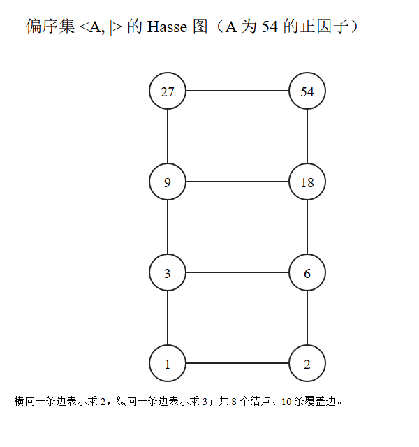
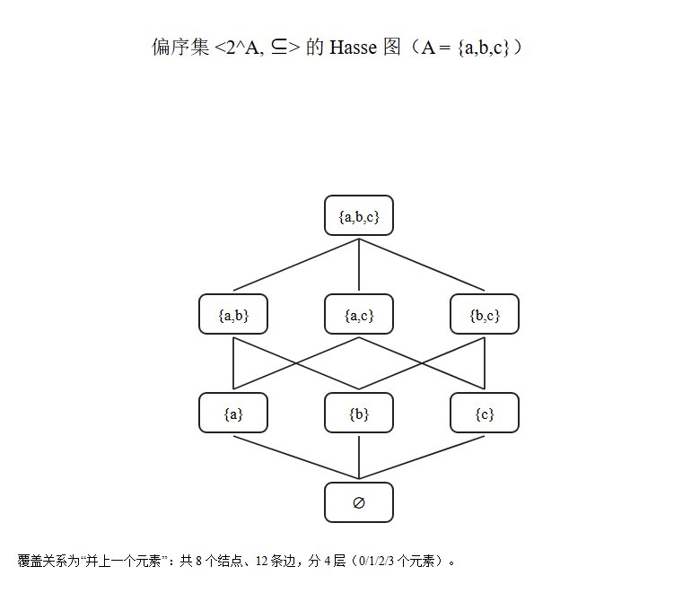

# 关系与函数：等价关系、Hasse 图与置换

日期：2026-10-27　课程：离散数学

> 这一轮做了六类题：等价关系证明、Hasse 图、全序子集与拓扑排序、单射满射判定、复合函数、置换与幂幺置换。共性方法是"先找判定条件，再找反例"。

## 一、等价关系证明的两套套路

**构造型：用表达式定义的关系**

$A=\{(a,b)\mid a,b\in\mathbb{N}^+\}$，$((a,b),(c,d))\in R\iff ad=bc$。

自反：$ab=ba$。对称：$ad=bc\Rightarrow cb=da$。传递：由 $ad=bc$ 与 $cf=de$，前者乘 $f$、后者乘 $b$，得 $adf=bcf=bde$，消去 $d$ 得 $af=be$。

这个关系本质是"两个分数相等"，等价类就是同一个有理数。

**边界提醒**：消去 $d$ 要求 $d\neq0$。若把 $\mathbb{N}$ 理解为含 0，传递性不成立，反例：$(1,1)\sim(0,0)$、$(0,0)\sim(1,2)$，但 $(1,1)\not\sim(1,2)$。答题时先声明"$a,b$ 为正整数，故可消去"。

**条件型：只给性质，反推缺的那条**

$R$ 对称且传递，若对每个 $x$ 存在 $y$ 使 $xRy$，证 $R$ 自反。

取任意 $x$，找到 $y$ 使 $xRy$；由对称得 $yRx$；由传递得 $xRx$。三步完成。

这个条件不能弱化：令 $R=\{(1,1)\}$，$A=\{1,2\}$，对称传递都成立，但 $2$ 没有出边，不自反。

## 二、Hasse 图：只画覆盖关系

覆盖：$x<y$ 且不存在 $z$ 使 $x<z<y$。传递性能推出来的关系全部省略，这是 Hasse 图与关系图的区别。

**54 的正因子**

$54=2\times3^3$，因子形如 $2^a3^b$，$a\in\{0,1\}$、$b\in\{0,1,2,3\}$，共 8 个：$1,2,3,6,9,18,27,54$。

判据：$y$ 恰好是 $x$ 乘一个质因子。乘 2 得横向边 4 条，乘 3 得纵向边 6 条，共 10 条。

**幂集格**

$A=\{a,b,c\}$，$2^A$ 有 8 个元素，覆盖关系是"再并上一个元素"，共 12 条边，分 1-3-3-1 四层。

**两图对比**

| | $2^A$ 的幂集格 | 54 的因子格 |
|---|---|---|
| 结构 | 三个二元链直积，1-3-3-1 | 二元链乘四元链，1-2-2-2-1 |
| 最长链 | 4 个元素 | 5 个元素 |
| 补元 | 每个元素有唯一补元（布尔格） | $3$ 无补元，不是有补格 |

共同点：都是 8 元有限分配格，都有最小元与最大元；都能写成指数向量逐坐标比较，只是一个分量取 0/1，一个取 0..3。

**迁移点**：54 换成 30（三个不同质数），因子格就与幂集格同构。质因数指数都为 1 时，因子格就是布尔格。

## 三、全序子集与线性扩展

**最长链**：链上每步至少加 1 个元素，所以从最小元走到最大元，元素个数固定。幂集格最长链 4 个元素，54 因子格 5 个。

**最长链的条数**：对应从最小元到最大元的覆盖路径数。幂集格中是三个元素的加入顺序，$3!=6$ 条；54 因子格中是 4 步里选 1 步乘 2，$\binom{4}{1}=4$ 条。

**线性扩展（拓扑排序）**：给 $2^A$ 找一个全序，使 $X\subset Y\Rightarrow X$ 在前。

按元素个数从小到大排即可：$\varnothing$、三个单元素集、三个二元集、$A$。

理由一句话：真子集的基数严格更小，按基数排序自动满足包含关系；同基数之间互不包含，谁前谁后都可以，所以答案不唯一。

## 四、单射与满射的判定

**单射**：解 $f(x_1)=f(x_2)$ 推出 $x_1=x_2$；或找一组不同输入给出同一输出否掉。

**满射**：比较值域与陪域。能算值域的直接看，算不出来的对任意 $y$ 反解 $x$。

| 映射 | 单射 | 满射 | 依据 |
|---|---|---|---|
| $\ln n$，$\mathbb{N}^+\to\mathbb{R}$ | ✓ | ✗ | 严格递增；值域离散，取不到 $1/2$ |
| $\pi(n)$，素数个数 | ✗ | ✓ | $\pi(3)=\pi(4)$；素数无穷保证每值可达 |
| $(n_1+1)^{n_2}$ | ✗ | ✗ | $2^2=4^1$；结果至少为 1 |
| $x^2+2x-15$ | ✗ | ✗ | 关于 $x=-1$ 对称；值域 $[-16,+\infty)$ |
| $1+2x^3$，$\mathbb{Z}\to\mathbb{Z}$ | ✓ | ✗ | 立方严格递增；只有奇数 |
| $(x\cup y,\ x\cap y)$ | ✗ | ✗ | $(\{a\},\{b\})$ 与 $(\{a,b\},\varnothing)$ 同像；交集必含于并集 |
| $x+y$，$\mathbb{R}^2\to\mathbb{R}$ | ✗ | ✓ | $(0,1)$ 与 $(1,0)$；$(z,0)$ |
| $xy$ | ✗ | ✓ | $(1,2)$ 与 $(2,1)$；$(z,1)$ |

## 五、复合函数

$(f\circ g)(x)=f(g(x))$，从右往左代入。$f(x)=2x$，$g(x)=x^2+x-1$，$h(x)=x-2$：

$f\circ g=2x^2+2x-2$；$g\circ f=4x^2+2x-1$；$f\circ h=2x-4$；$h\circ h\circ g=x^2+x-5$。

两个要点：复合不可交换（$f\circ g\neq g\circ f$）；三层复合从最右边开始，或利用性质简化——$h$ 是减 2，套两次就是减 4。

## 六、置换

**基本记号**：$\pi=\begin{pmatrix}1&2&3&4\\2&3&1&4\end{pmatrix}=(1\,2\,3)$，剩下的是固定点。

**幂与逆**：3 循环阶为 3，$\pi^3=e$，$\pi^{-1}=\pi^{2}$。写成两行式就是把上下两行倒过来再整理。

**幂幺置换**：满足 $\pi^2=e$ 的置换，即每个循环长度都整除 2，所以是若干不相交对换的乘积。

$A=\{1,2,3,4\}$ 上共 10 个：恒等 1 个、单个对换 $\binom{4}{2}=6$ 个、两个不相交对换 3 个（$(1\,2)(3\,4)$、$(1\,3)(2\,4)$、$(1\,4)(2\,3)$）。

数后三个的办法：固定最小元素，它有几个可选伙伴就有几种配对，剩下两个自动成对。一般公式是 $(n-1)!!$。

## 七、易错点

Hasse 图别画传递关系。$1\mid18$ 成立但中间有元素，不画。

$\mathbb{N}$ 是否含 0 会影响结论，卷面上先声明。

复合函数顺序：$f\circ g$ 是先 $g$ 后 $f$，写反整题皆错。

单射的否定只需一个反例，不必证明"都不行"。

幂幺置换不等于"每个元素都动"，有固定点也允许。

## 八、自测

1. 若 $R$ 自反且传递，是否一定是等价关系？

2. 72 的正因子构成多少个元素的偏序集？最长链几个元素？

3. $f(x)=x^3$ 在 $\mathbb{R}\to\mathbb{R}$ 上是双射吗？在 $\mathbb{Z}\to\mathbb{Z}$ 上呢？

4. $A$ 有 5 个元素时，幂幺置换共有多少个？

5. $\langle 2^A,\subseteq\rangle$ 中，$\{a\}$ 的补元是哪个？54 因子格中 9 的补元存在吗？
