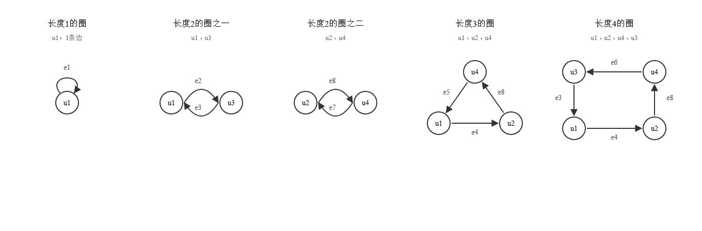
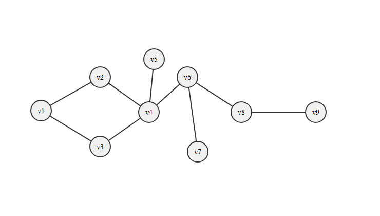

# 图论：握手定理、割边割点与同构判定

日期：2026-10-29　课程：离散数学

> 这一轮做的都是图论证明与判定题：二部图边数上界、由度数求阶数、同构判定、有向图的圈与回路、割边与圈的等价性、割点割边识别。共通工具只有两件：握手定理，和“删掉之后连通性怎么变”。

## 一、握手定理及其分支用法

$$\sum_{v\in V} d(v) = 2|E|$$

证明用双计数：每条边贡献两个端点，所以按边数一遍、按顶点度数一遍，数的是同一批东西。

**对连通分支同样成立**。分支本身是一个图，它的所有边两端都在内部，顶点度数也不因拆分改变，所以上式在分支上原样成立。

**由此得推论**：任何图中奇数度顶点的个数必为偶数。因为每个连通分支的度数和是偶数，而偶数和只能由偶数个奇数组成。

## 二、二部图的边数上界

设两部为 $X$、$Y$，$|X|=a$，$|Y|=b$，$a+b=n$。

简单性给出 $m\le ab$（每对跨部顶点最多一条边）；均值不等式给出 $ab\le\left(\frac{n^2}{4}\right)$。合起来 $m\le\frac{n^2}{4}$。

取等当且仅当 $a=b=\frac{n}{2}$ 且所有跨部边都存在，即完全二部图 $K_{\frac{n}{2},\frac{n}{2}}$。

两个条件各管一半：二部管“边只能在两部之间”，简单管“每对最多一条”。缺了简单性，平行边可以让边数任意大。

## 三、同构判定：从粗到细

先比顶点数、边数、度数列，任一不等直接判不同构。

全都相等时，再比更细的不变量：长度相同的圈数、割点个数、直径、从特殊顶点出发的距离分布、去掉某点后各分支的阶数。

例：两个 6 顶点树，度数列都是 $(3,2,2,1,1,1)$，直径都是 4。但唯一的三度点到三个叶子的距离集合一个是 $\{1,1,3\}$，一个是 $\{1,2,2\}$，故不同构。

## 四、有向图的圈与回路

**圈**：起点等于终点、顶点不重复的闭合通路（简单回路）。
**回路**：起点等于终点，顶点可重复（边不重复）。

长度 1 的圈只能来自自环；长度 2 的圈需要同一对顶点间有方向相反的两条边，这是画图时最容易漏看的地方。

以图 10-31 为例（边：e1 是 $u_1$ 自环，e2 $u_1\to u_3$，e3 $u_3\to u_1$，e4 $u_1\to u_2$，e5 $u_4\to u_1$，e6 $u_4\to u_3$，e7 $u_4\to u_2$，e8 $u_2\to u_4$）：

长度 1：$u_1\to u_1$，1 个。
长度 2：$u_1\to u_3\to u_1$；$u_2\to u_4\to u_2$，2 个。
长度 3：$u_1\to u_2\to u_4\to u_1$，1 个。
长度 4：$u_1\to u_2\to u_4\to u_3\to u_1$，1 个。

回路在圈的基础上可以借自环或往返边加长度。按“旋转视为同一条”的口径，长度 3 到 6 每种长度恰好 2 条；按“不同起点算不同”的口径，数量是 $2L$。

“以子图形式画出”指每个圈单独画一张小图，只保留该圈经过的顶点和边，其余全部去掉。这样每个子图就是一个闭环，长度与是否重复顶点一眼可辨。

## 五、割边与圈的等价关系

**边 $e$ 是割边，当且仅当 $e$ 不在任何圈中。**

必要性：若 $e=uv$ 在圈 $C$ 上，则圈的另一侧给出一条 $u$ 到 $v$ 的通路，删掉 $e$ 后 $u,v$ 仍连通；其余点若原本的通路经过 $e$，把 $e$ 换成这条替代通路即可。于是 $G-e$ 连通，$e$ 不是割边。

充分性：若 $e$ 不在任何圈中而 $e$ 又不是割边，则 $G-e$ 连通，存在 $u$ 到 $v$ 的通路，它与 $e$ 合起来就是一个含 $e$ 的圈，矛盾。

直观：圈上的边“两头有两条路”，删一条不断；割边“只有一条路”，删了就断。

## 六、割点与割边的识别

割边判定用上面那条：在圈上就不是，不在圈上就是。

割点判定看“去掉它之后连通分支数是否增加”。

以图 10-32 为例（$v_4$ 是菱形右角，$v_5$ 上方悬挂点，$v_6$ 右上，$v_7$ 右下，$v_8$ 右中，$v_9$ 最右）：

割点 3 个：$v_4$（左右两半断开）、$v_6$（$v_7$ 孤立、右段脱离）、$v_8$（$v_9$ 孤立）。
割边 5 条：$v_4v_5$、$v_4v_6$、$v_6v_7$、$v_6v_8$、$v_8v_9$。

菱形那四条边都在圈上，都不是割边。三条叶子的边必然是割边。$v_4v_6$ 与 $v_6v_8$ 绕不出圈，也是割边。

## 七、抽屉原理：度数必重复

$n\ge 2$ 的简单图中至少有两个顶点度数相同。

$n$ 个顶点度数只能取 $0$ 到 $n-1$，共 $n$ 个值，但其中 $0$ 与 $n-1$ 不能同时出现：度数为 $n-1$ 意味着该点与所有点相邻，于是没有孤立点；反之有孤立点就没有全连点。

所以实际可用取值至多 $n-1$ 个，$n$ 个顶点必有两者同度。

## 八、易错点

度数之和是 $2|E|$，不是 $|E|$。求阶数时先减已知贡献再除，别忘乘 2。

“奇数度顶点个数为偶数”是对每个连通分支分别成立，不是仅对整图。

二部图的边数上界要同时用上“二部”和“简单”，只写 $ab$ 不说明理由会扣分。

同构判定不能只看度数列和直径，要继续比距离分布或分支结构。

长度 2 的圈要求两条方向相反的边，图中两条平行弧最容易看漏。

圈要求顶点不重复，回路允许重复顶点但边不重复，题目分开问就是在考这条区别。

割边等价于“不在任何圈中”，割点没有这种简洁等价，必须看删点后的连通分支数。

## 九、自测

1. 12 个 3 度顶点和若干 2 度顶点共 21 条边，求阶数。（答：15）
2. 简单二部图 8 个顶点最多几条边？取等时是什么图？（答：16，$K_{4,4}$）
3. 一棵树的所有边都是割边吗？为什么？（答：是，树上没有圈）
4. 图 10-31 里长度 5 的回路有几条（旋转视为同一条）？（答：2 条）
5. 若图中恰有 4 个奇数度顶点，它们能分成几条不相交通路？（答：2 条）
