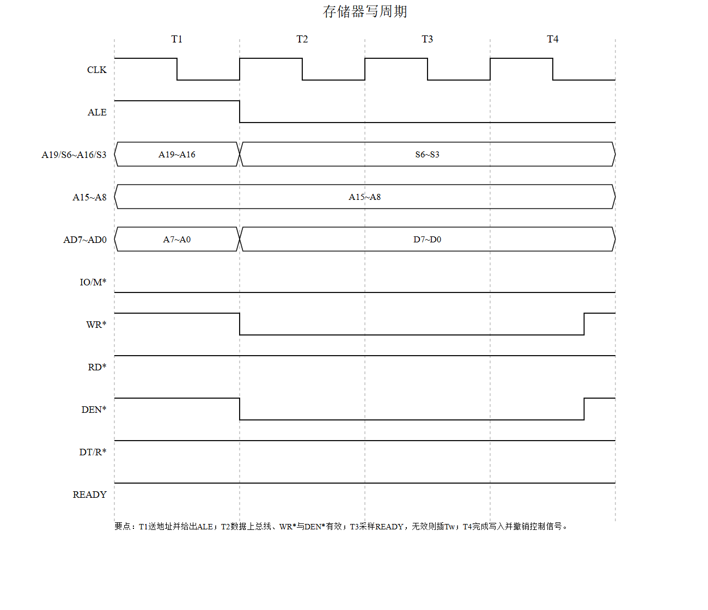
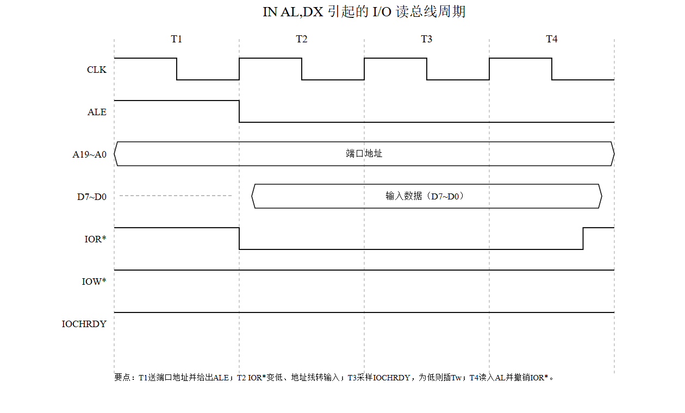

# 总线、总线周期与 PC 总线信号

日期：2026-10-27　课程：汇编语言与微机接口

> 这一轮把总线这块补了一遍：总线的分层、带宽怎么算、三态是什么意思、四个关键引脚、三层时间体系，以及两种典型周期的波形。附两张自己画的时序图。

## 一、三类信号线与三层总线

按信号性质分三类：**数据总线**（双向，搬内容）、**地址总线**（单向输出，指明去哪）、**控制总线**（各方向都有，下命令）。电源和地线只供电不传信息，不算信号线。

按层次分三层：

| 层次 | 别名 | 范围 |
|---|---|---|
| 片总线 | 元件级总线 | 芯片与芯片之间，如 CPU 到存储器 |
| 内总线 | 系统总线、板级总线 | 机箱内插件板之间，如 PC 总线、ISA、PCI |
| 外总线 | 通信总线 | 设备之间，如串口、并口、USB |

范围由小到大：芯片间 → 板卡间 → 设备间。

## 二、带宽怎么算

带宽 = 每次传送字节数 × 每秒传送次数。

ISA 总线时钟 8MHz，每两个时钟传一个 16 位数据：

8MHz ÷ 2 = 4M 次/秒，每次 2 字节 → **8MB/s**（合 64Mbps）。

算的时候注意两点：除的是“每几次时钟传一次”，不是时钟频率本身；乘的是字节数不是位数，最后要换成 MB/s 或 Mbps。

## 三、三态与高阻

三态指输出级有高电平、低电平、高阻三种状态。

高阻不是输出 0 或 1，而是**主动松手**：输出级上下两只管子同时截止，引脚与内部电路断开，既不输出也不吸收电流，电压由外部电路决定。多主控系统（DMA、多处理器）能共存，靠的就是它。

最小组态下 8088 具备三态的引脚：AD0~AD7、A8~A15、A16/S3~A19/S6，以及 ALE、RD*、WR*、IO/M*、DEN*、DT/R*、SS0*、INTA*、HLDA。

## 四、四个关键引脚

**RESET**：复位输入，高有效，至少保持 4 个时钟周期。有效时终止当前操作、寄存器初始化，CS=FFFFH、IP=0000H，撤销后从 FFFF0H 取指。

**HOLD**：总线保持请求，高有效，由 DMA 等主控设备发出。CPU 在当前总线周期结束后响应，输出 HLDA 高，同时把地址、数据、控制引脚全置高阻，让出总线。

**NMI**：非屏蔽中断，上升沿触发，不受 IF 控制，类型号固定为 2，转 00008H 取向量。用于电源故障这类紧急事件。

**INTR**：可屏蔽中断请求，高有效，IF=1 才响应，响应后从数据总线读中断类型号，据此查中断向量表。

## 五、三层时间体系

**时钟周期**：CLK 的一个完整周期，最小时间单位。CLK=5MHz 时 T=200ns。

**总线周期**：CPU 完成一次总线操作（访问一次存储器或一个端口）所需时间，基本总线周期由 **4 个 T** 组成。

**指令周期**：执行一条指令所需时间，由若干个总线周期组成。中断响应、DMA 这类硬件触发的周期不属于指令周期。

## 六、存储器写周期

T1 送出地址并给出 ALE，ALE 下降沿把地址锁进 8282；T2 数据上总线，WR*、DEN* 有效，IO/M* 保持低；T3 上升沿采样 READY，无效则在 T3 与 T4 之间插入一个或多个 Tw，期间所有信号保持；T4 前沿数据被写入，控制信号撤销，T4 结束后地址撤销。

A16~A19 在 T1 传地址高 4 位，T2 起改传状态 S6~S3，是总线复用的典型画法。

撤销顺序有讲究：先撤写控制信号，再断数据，最后撤地址。反过来写信号还低而地址已变，会误写到别的单元。

## 七、一条指令涉及几个总线周期

`ADD [2000H],AX`，指令 3 字节，操作是存储器读—改—写。

取指：8088 外部数据线只有 8 位，一个字节一个周期，共 **3 个存储器读周期**。

执行：16 位操作数拆成两次字节访问，先读低字节、读高字节，再写低字节、写高字节，共 **2 读 + 2 写 = 4 个总线周期**。

合计 7 个。严格说 8088 有 4 字节预取队列，取指与执行会重叠，但题目问周期数量与类型时按分开计数是标准答法。

## 八、PC 总线六根线

**D7~D0** 8 位双向数据线，插槽上独立引出，不再与地址复用。

**A19~A0** 20 位单向地址线，寻址 1MB；访问 I/O 时 A19~A16 恒为 0，只用 A15~A0，端口最多 64K 个。

**ALE** 高有效，标识总线周期起始，地址已在板上锁存。

**IOR*** / **IOW*** 低有效，读/写 I/O 端口的选通，由 IO/M* 与 RD*、WR* 组合而成。

**IOCHRDY** 高有效输入，即 CPU 的 READY 经板上逻辑引出，扩展卡拉低可插入等待周期。

`IN AL,DX` 是 I/O 读：T1 送端口地址、ALE 高；T2 IOR* 变低，D7~D0 由高阻转为输入；T3 采样 IOCHRDY；T4 数据读入 AL 并撤销 IOR*。整周期 IOW* 保持高，因为不是写操作；IO/M* 为高，因为是访问 I/O 而不是存储器。

## 九、易错点

高阻不等于输出 0。波形图上的虚线段表示器件未驱动总线，不能从里面读数据。

带宽单位是字节不是位，8MB/s 与 64Mbps 是同一件事的两种说法。

Tw 插在 T3 与 T4 之间，不是 T4 之后；插几个取决于外设，READY 有效就进 T4。

I/O 周期 A19~A16 恒为 0，这一点常被忽略。

平线不是漏画。时序图里某根线整周期保持高电平，就画一条直线。

## 十、自测

1. ISA 8MHz、每 2 个时钟传 16 位，带宽多少？若每次传 32 位呢？

2. 高阻状态下引脚电压由谁决定？

3. NMI 和 INTR 在触发方式、屏蔽条件、类型号来源上有什么区别？

4. `ADD [2000H],AX` 为什么执行阶段要 4 个总线周期而不是 2 个？

5. 存储器写周期里，为什么必须先撤写信号再撤地址？
