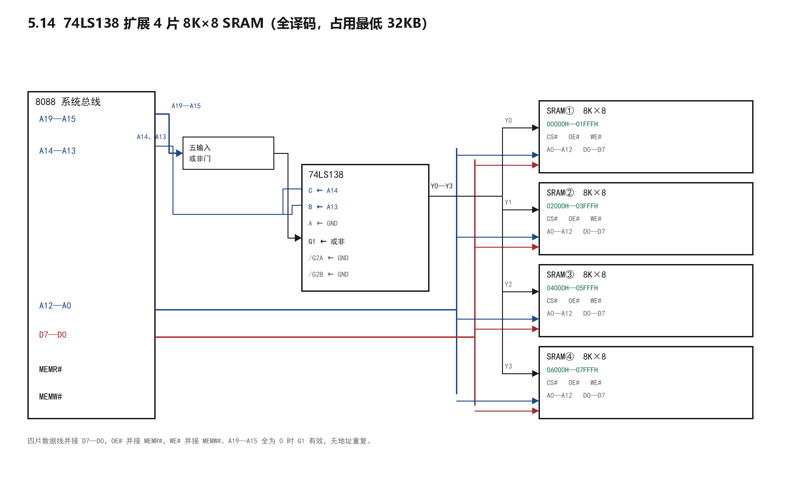

# 存储器扩展与地址译码

日期：2026-11-10　课程：汇编语言与微机接口

对应教材 5.10 至 5.14 与第五章习题。

## 一、地址线的两拨分工

20 根地址线不是全都用来找格子的。

低若干根进芯片内部编址，片内有多少个单元就取多少根。8K 取 13 根，32K 取 15 根。

剩下的高位站在芯片外面，负责认片，判断当前访问的是不是这一片。

一句话，低位找格子，高位挑芯片。

## 二、位扩展与字扩展

位扩展解决位数不够。多片并联，地址线和片选共用，数据线各接数据总线的一位。

字扩展解决字数不够。多组拼合，数据线并接，用不同片选区分。

例，21256 为 256K×1，构成 512KB：

位数方向 8 除以 1 得 8 片，字数方向 512K 除以 256K 得 2 组，共 16 片。

8 片一组共用 A0 至 A17 与片选，数据线分接 D0 至 D7，得 256KB。

两组数据线并接，用 A18 译码出两个片选，得 512KB。

## 三、全译码与部分译码

全译码指所有剩余高位都参加译码。每个单元只有一个地址，不会重复，电路复杂。

部分译码指只有部分高位参加译码。没参加的那几位取什么值都指向同一单元，于是出现地址重复。

漏掉 1 位，地址重复 2 份。漏掉 2 位，重复 4 份。

判断方法：数片内地址线根数，再看剩余高位是否全部接进译码电路。

## 四、门电路译码（教材图5-23）

32K×8 的芯片，片内用 A14 至 A0 共 15 根，剩 A19 至 A15 五根认片。

取 A19 至 A15 等于 00001。

四位 0 各加一个反相圈，0 变 1。A15 本身是 1，直接进。

五个输入全为 1 时与非门输出 0，片选低电平有效，这片被选中。

起始地址由 A15 决定，1 乘 2 的 15 次方等于 32768，即 8000H。末地址 0FFFFH。

记忆：该为 1 的直接进，该为 0 的先反相，全 1 才输出 0。

## 五、用 74LS138 做多片扩展（习题 5.14）

题目：3:8 译码器 74LS138 加多片 8K×8，全译码，占从最低地址起的 32KB。

每片 8K 需 A0 至 A12 十三根，模块 32K 需 A0 至 A14 十五根，差两位正好选四片。

A0 至 A12 并接到四片做片内寻址。A14、A13 接 138 的 C、B，第三端 A 接地，只用 Y0 至 Y3。

A19 至 A15 五根全为 0 才在本范围内，把它们送进五输入或非门，输出接 G1。/G2A 与 /G2B 接地。

四片地址依次为 00000H 至 01FFFH、02000H 至 03FFFH、04000H 至 05FFFH、06000H 至 07FFFH。

因六根高位全部参加译码，不存在地址重复。

## 六、部分译码的实例（习题 5.13）

图中有两片 256K×8 与两片 64K×8。

2:4 译码器只用 A19、A18 两位，A19A18 等于 00 选第一片 256K，等于 01 选第二片 256K。

A19A18 等于 11 那一路再与 A16 组合，A16 为 0 选第三片 64K，为 1 选第四片 64K。

A17 没有参加译码，于是第三片的 64KB 在两个位置重复出现，第四片同理。

这就是部分译码，容量不变，地址翻倍。

## 七、做题固定步骤

第一步，算片数，总容量除以单片容量。

第二步，定片内地址线，按单片单元数的对数取。

第三步，定高位，总地址位数减片内位数，剩下的全要参加译码。

第四步，多片时看中间那几位能不能正好做片选，能就用译码器。

第五步，写出每片地址范围，起始地址由高位取值换算，末地址加容量减一。

## 八、常见错误

把 8K 的片内地址根数写成 14 根，实际 2 的 13 次方才是 8192。

高位漏掉一位，地址出现镜像却当成没问题。

写地址范围时把重复段算进容量，容量凭空变大。

8088 配 8 位芯片时还去接 BHE 和 BLE，多此一举，只有 16 位数据总线才需要。
